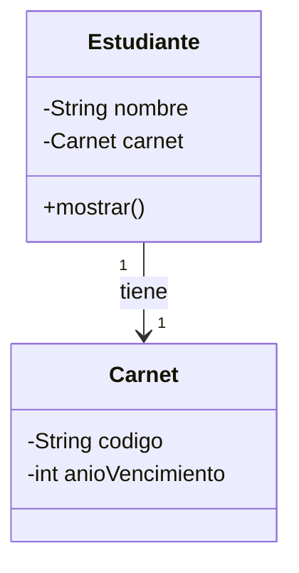
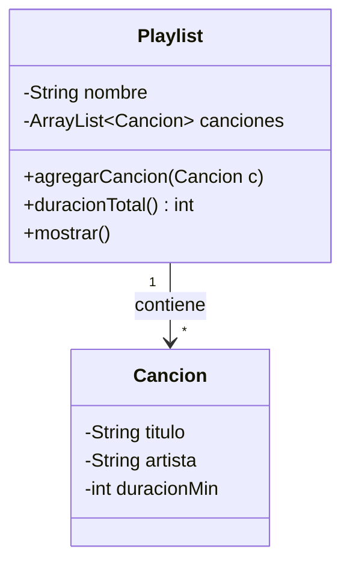
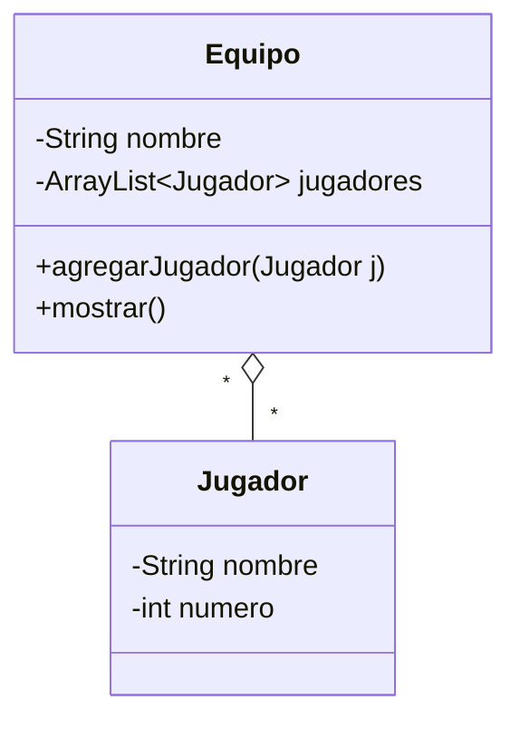
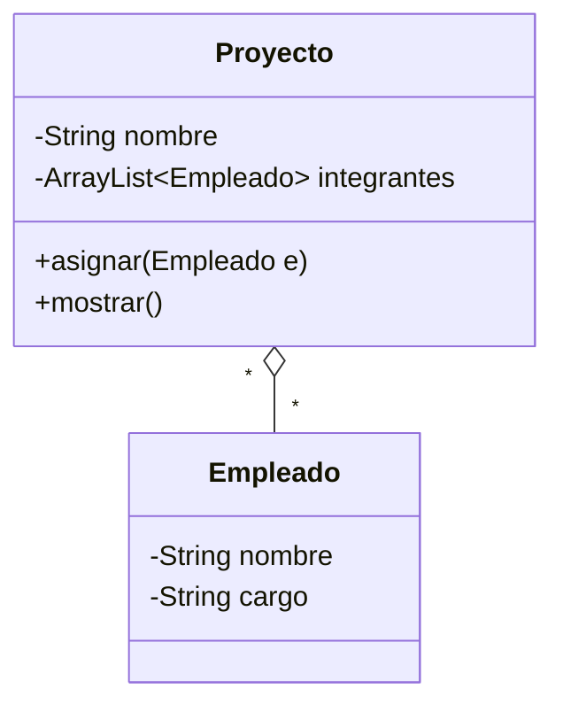
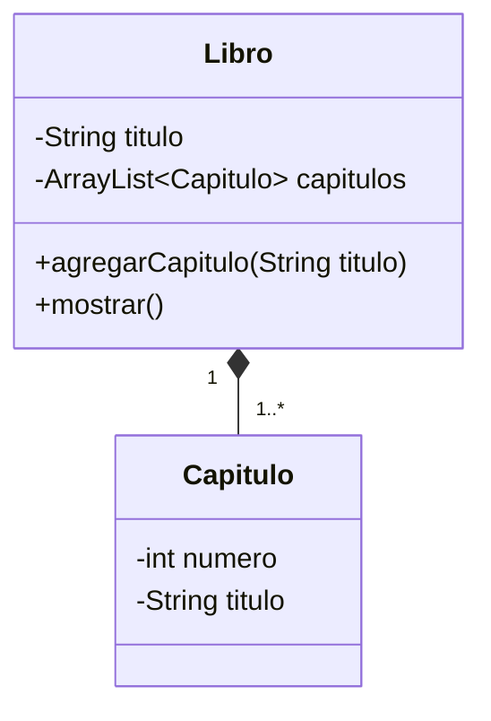
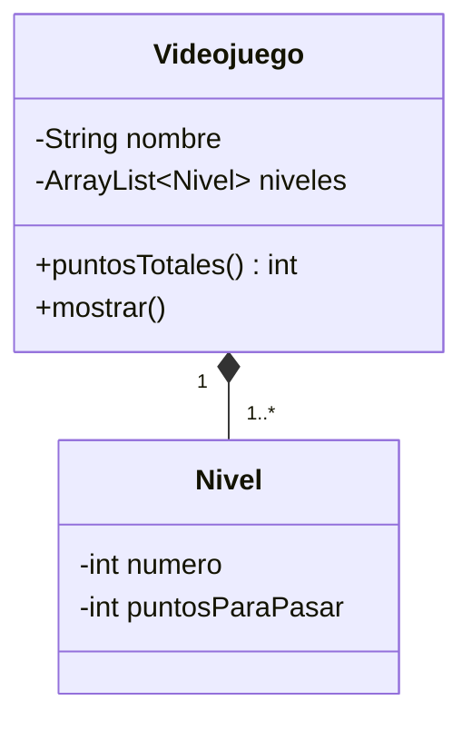

# Prácticas de clase · Semana 09

Seis prácticas para hacer en clase: **dos de asociación, dos de agregación y dos de composición**.
Cada una tiene un caso, su diagrama UML, los pasos a seguir y la salida que debes obtener.

**Cómo trabajar cada práctica**

1. Lee el caso y mira el diagrama UML.
2. Crea un proyecto (o una carpeta) nuevo en tu IDE.
3. Sigue los pasos en orden: primero la clase "parte", luego la clase "todo", al final el `Main`.
4. Compara tu salida con la **salida esperada**.
5. Responde la pregunta final con tus palabras.

---

# Parte 1 · Asociación

## Práctica 1 · Estudiante – Carnet (1 a 1)

**Caso:** cada estudiante tiene un único carnet. El estudiante conoce su carnet, pero el carnet no sabe de quién es.



**Pasos**

1. Crea la clase `Carnet` con los atributos `codigo` (`String`) y `anioVencimiento` (`int`).
2. Agrega un constructor que reciba ambos valores y sus getters.
3. Crea la clase `Estudiante` con el atributo `nombre` y un atributo `carnet` de tipo `Carnet`.
4. Escribe un constructor que reciba el `nombre` **y el `Carnet`** (la asociación es un atributo).
5. Escribe el método `mostrar()` que imprima el nombre y los datos del carnet.
6. En `Main`: primero crea el `Carnet`, luego el `Estudiante` pasándole ese carnet, y llama a `mostrar()`.

**Salida esperada**

```
Rosa Vega tiene el carnet U2026001 (vence 2028)
```

**Piensa:** ¿por qué `Carnet` no tiene ningún atributo de tipo `Estudiante`?

---

## Práctica 2 · Playlist – Cancion (1 a muchos)

**Caso:** una playlist contiene muchas canciones. Queremos listarlas y calcular la duración total.



**Pasos**

1. Crea la clase `Cancion` con `titulo`, `artista` y `duracionMin` (`int`), su constructor y sus getters.
2. Crea la clase `Playlist` con el atributo `nombre` y una lista: `private ArrayList<Cancion> canciones = new ArrayList<>();`
3. Recuerda el `import java.util.ArrayList;` al inicio del archivo.
4. Escribe `agregarCancion(Cancion c)` que agregue la canción a la lista con `add`.
5. Escribe `duracionTotal()`: recorre la lista con un `for` y suma las duraciones.
6. Escribe `mostrar()`: imprime el nombre, cada canción numerada (`1.`, `2.`, ...) y la duración total.
7. En `Main`: crea una playlist, agrégale 3 canciones y llama a `mostrar()`.

**Salida esperada**

```
Playlist: Para estudiar
1. Lofi Beats - Chillhop (3 min)
2. Focus - Brain Waves (4 min)
3. Rain Sounds - Nature (5 min)
Duración total: 12 min
```

**Piensa:** ¿en qué clase vive la lista y por qué en esa?

---

# Parte 2 · Agregación

> En la agregación **la parte se crea afuera** (en `Main`) y llega al "todo" por parámetro. Si el "todo" desaparece, la parte sigue existiendo.

## Práctica 3 · Equipo – Jugador

**Caso:** un jugador puede estar en varios equipos (por ejemplo, un préstamo). Los jugadores existen aunque el equipo desaparezca.



**Pasos**

1. Crea la clase `Jugador` con `nombre` y `numero`, su constructor y sus getters.
2. Crea la clase `Equipo` con `nombre` y una lista de jugadores (`ArrayList<Jugador>`).
3. Escribe `agregarJugador(Jugador j)`: **recibe** el jugador ya creado y lo agrega a la lista.
4. Escribe `mostrar()`: imprime `"<nombre> tiene N jugador(es)"`.
5. En `Main`: crea **primero** dos jugadores (`new Jugador(...)`).
6. Crea dos equipos. Agrega ambos jugadores al primer equipo y **solo el primer jugador** al segundo equipo.
7. Muestra los dos equipos. Luego haz `alianza = null;` e imprime que el jugador sigue existiendo.

**Salida esperada**

```
Alianza tiene 2 jugador(es)
Universitario tiene 1 jugador(es)
Se elimina el equipo Alianza...
El jugador sigue existiendo: Lucía Paredes (#10)
```

**Piensa:** ¿dónde está el `new Jugador`? ¿Por qué eso hace que sea agregación y no composición?

---

## Práctica 4 · Proyecto – Empleado

**Caso:** una empresa asigna empleados a proyectos. Un empleado puede trabajar en varios proyectos y no desaparece si un proyecto se cierra.



**Pasos**

1. Crea la clase `Empleado` con `nombre` y `cargo`, su constructor y sus getters.
2. Crea la clase `Proyecto` con `nombre` y una lista `integrantes`.
3. Escribe `asignar(Empleado e)`: agrega el empleado recibido a la lista.
4. Escribe `mostrar()`: imprime el proyecto, la cantidad de integrantes y cada uno con su cargo.
5. En `Main`: crea dos empleados y dos proyectos (`Web` y `App`).
6. Asigna ambos empleados a `Web` y solo el segundo a `App`.
7. Muestra los dos proyectos, cierra el proyecto `Web` (`web = null;`) y comprueba que el empleado sigue existiendo.

**Salida esperada**

```
Proyecto Web: 2 integrante(s)
- Sofía Lara (Analista)
- Pedro Gil (Programador)
Proyecto App: 1 integrante(s)
- Pedro Gil (Programador)
Se cierra el proyecto Web.
Pedro Gil sigue trabajando en la empresa.
```

**Piensa:** Pedro está en dos proyectos a la vez. ¿Eso sería posible en una composición?

---

# Parte 3 · Composición

> En la composición **el "todo" crea sus partes** (el `new` está dentro del todo). Desde `Main` no se crea ninguna parte. Si el "todo" desaparece, sus partes también.

## Práctica 5 · Libro – Capitulo

**Caso:** un libro está formado por capítulos. Un capítulo no tiene sentido fuera de su libro.



**Pasos**

1. Crea la clase `Capitulo` con `numero` (`int`) y `titulo`, su constructor y sus getters.
2. Crea la clase `Libro` con `titulo` y una lista de capítulos.
3. Escribe `agregarCapitulo(String tituloCapitulo)`: recibe **solo el título** (no un `Capitulo`).
4. Dentro de ese método calcula el número (`capitulos.size() + 1`) y haz **el `new Capitulo(...)`** ahí mismo.
5. Escribe `mostrar()`: imprime el título del libro, la cantidad de capítulos y cada capítulo.
6. En `Main`: crea el libro y llama 3 veces a `agregarCapitulo(...)`. **No uses `new Capitulo` en `Main`.**

**Salida esperada**

```
Libro: Programación en Java (3 capítulos)
Cap. 1: Clases y objetos
Cap. 2: Relaciones entre clases
Cap. 3: Colecciones
```

**Piensa:** ¿por qué `agregarCapitulo` recibe un `String` y no un `Capitulo`?

---

## Práctica 6 · Videojuego – Nivel

**Caso:** un videojuego se construye con varios niveles. Cada nivel pide más puntos que el anterior (`numero * 100`).



**Pasos**

1. Crea la clase `Nivel` con `numero` y `puntosParaPasar`. El constructor recibe solo el `numero` y calcula `puntosParaPasar = numero * 100`.
2. Crea la clase `Videojuego` con `nombre` y una lista de niveles.
3. Escribe el constructor `Videojuego(String nombre, int cantidadNiveles)`.
4. Dentro del constructor usa un `for` de `1` a `cantidadNiveles` y haz `niveles.add(new Nivel(i));`.
5. Escribe `puntosTotales()`: suma los `puntosParaPasar` de todos los niveles.
6. Escribe `mostrar()`: imprime el nombre, cada nivel y los puntos totales.
7. En `Main`: crea el videojuego con 3 niveles y llama a `mostrar()`. **No uses `new Nivel` en `Main`.**

**Salida esperada**

```
Super Java tiene 3 niveles:
Nivel 1: 100 puntos para pasar
Nivel 2: 200 puntos para pasar
Nivel 3: 300 puntos para pasar
Puntos totales: 600
```

**Piensa:** si borras el objeto `Videojuego`, ¿qué pasa con sus `Nivel`?

---

## Para cerrar

Completa esta tabla con tus palabras:

| Relación | ¿Quién hace el `new` de la parte? | ¿Qué pasa con la parte si desaparece el todo? |
|---|---|---|
| Asociación | | |
| Agregación | | |
| Composición | | |
