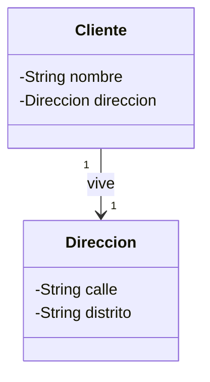
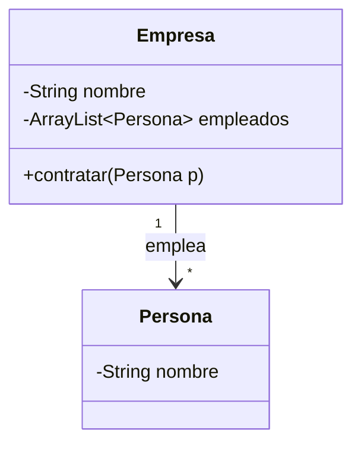
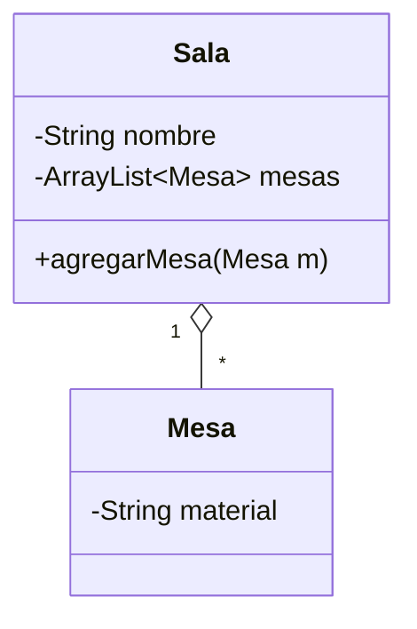
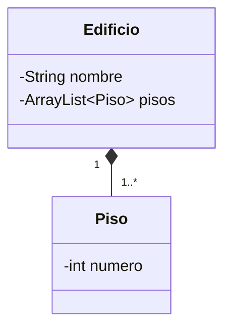
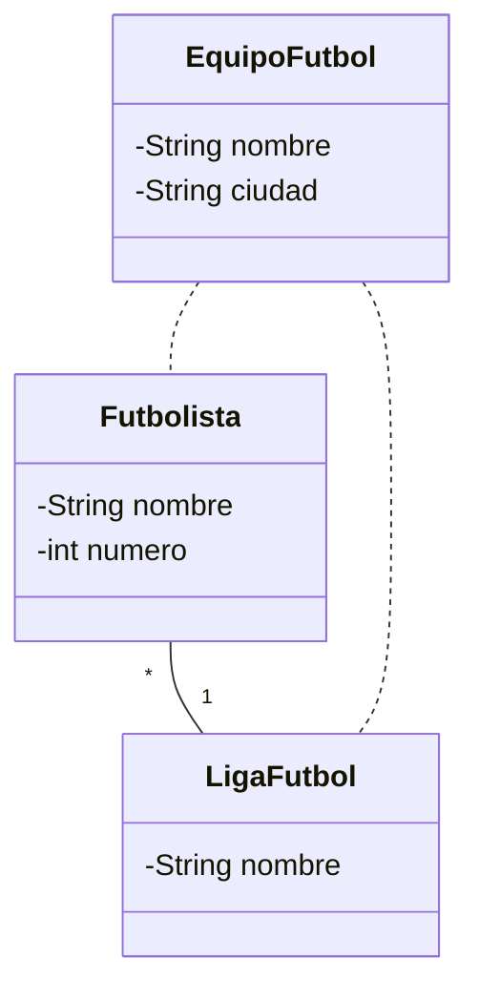
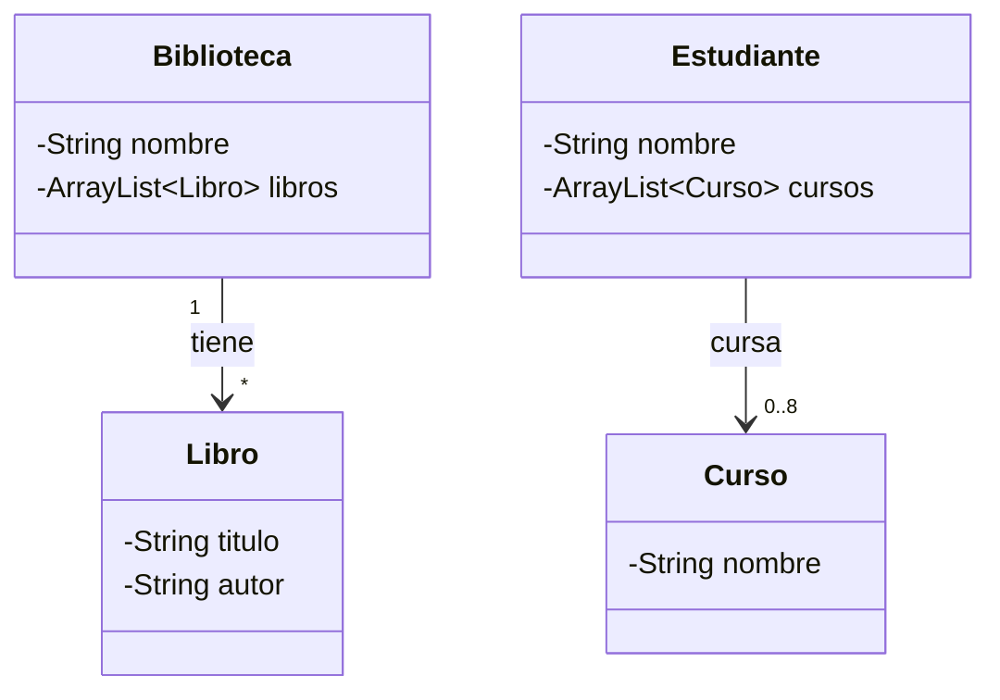

# USIL – Programación Orientada a Objetos I · Semana 09

## Relaciones entre clases: del diagrama UML al código Java

Código que acompaña la sesión de **asociación, agregación y composición**.
Cada carpeta es un proyecto independiente con su propio `Main.java`.
Estos ejemplos acompañan la **explicación de la clase** (diapositivas *Relación de Asociación*): primero revisa el diagrama y la explicación, y luego el código.

## Del diagrama al código (resumen)

| En el diagrama UML | En Java |
|---|---|
| Multiplicidad `1` | un atributo: `private Direccion direccion;` |
| Multiplicidad `0..1` | igual, pero puede valer `null` |
| Multiplicidad `*` o `1..*` | una lista: `private ArrayList<Persona> empleados;` |
| Navegabilidad `→` | solo la clase de origen guarda la referencia |
| Agregación `◇` | la parte **llega por parámetro** (se crea afuera) |
| Composición `◆` | el todo **hace el `new`** de la parte |

---

## Ejemplo01 · Asociación 1 a 1: `Cliente` – `Direccion`

El cliente conoce su dirección; la dirección no conoce al cliente.

📁 [`Ejemplo01`](Ejemplo01)

## Ejemplo02 · Asociación 1 a muchos: `Empresa` – `Persona`

La lista de empleados vive en la clase del lado "uno" (`Empresa`).

📁 [`Ejemplo02`](Ejemplo02)

## Ejemplo03 · Agregación: `Sala` – `Mesa`

La mesa **existe por sí sola** y puede estar en varias salas. La `Sala` no hace `new Mesa`: la recibe por parámetro.

📁 [`Ejemplo03`](Ejemplo03)

## Ejemplo04 · Composición: `Edificio` – `Piso`

El piso **no existe sin el edificio**: el `Edificio` hace el `new Piso(...)` en su constructor.

📁 [`Ejemplo04`](Ejemplo04)

## Ejemplo05 · Clase de asociación: `EquipoFutbol`

La relación entre `Futbolista` y `LigaFutbol` guarda información propia (nombre y ciudad del equipo), por eso se convierte en una clase. En el diagrama de clases del curso, `EquipoFutbol` se une con una línea punteada a la asociación; aquí se muestra con líneas punteadas hacia las dos clases que relaciona.

📁 [`Ejemplo05`](Ejemplo05)

---

## Ejercicios

| Carpeta | Ejercicio | Qué debes hacer |
|---|---|---|
| [`Ejercicio01`](Ejercicio01) | `Biblioteca` – `Libro` | Completar los 4 `TODO` de `Biblioteca` |
| [`Ejercicio02`](Ejercicio02) | `Estudiante` – `Curso` (0 a 8) | Escribir `inscribir` y `mostrarCursos`; el curso 9 se rechaza |
| [`Ejercicio03`](Ejercicio03) | Caso Blog | Diseñar el diagrama y completar las clases |

> `Ejercicio02` no compila hasta que escribas `inscribir` y `mostrarCursos`: es lo esperado.

**Pista para decidir entre agregación y composición:** ¿qué pasa con la parte cuando desaparece el todo? ¿Dónde está el `new`?
